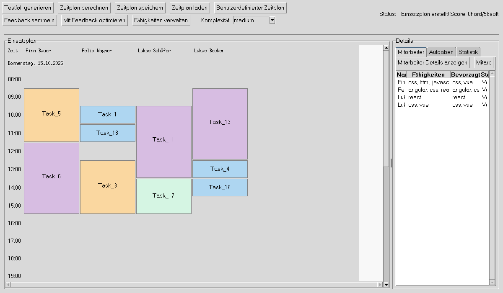
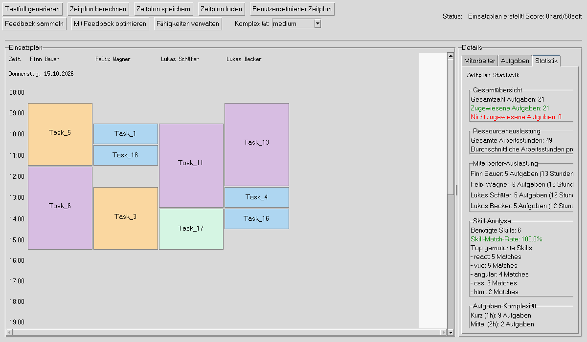

# Workforce Scheduling

[](https://github.com/maxikrueger/workforce-scheduling/actions/workflows/ci.yml)


**A desktop application that assigns tasks to employees and time slots with a constraint solver and refines the plan with employee feedback.**

Built as the software part of my bachelor's thesis. The planner models skills, availability
and working hours as hard and soft constraints, lets OptaPy (a Python wrapper around
OptaPlanner) search for the best assignment, and visualises the result as a day-by-employee
calendar. Employees can then rate their assignments ("Find ich gut" / "Lieber nicht"), and the
next optimisation run takes those ratings into account.

The user interface is in German.



<table>
  <tr>
    <td></td>
  </tr>
  <tr>
    <td align="center"><sub>Statistics: assignment rate, workload per employee, skill match rate</sub></td>
  </tr>
</table>

## Features

- **Constraint-based optimisation** with a hard/soft score
  - Hard: required skills, no overlapping tasks per employee, employee available, tasks start and end within working hours (08:00–16:00)
  - Soft: reward skill matches and preferred skills, prefer core hours, apply employee feedback
- **Feedback loop**: employees rate their assigned tasks; "Lieber nicht" pushes the solver to give the task to someone else, "Find ich gut" keeps it
- **Test case generator** with four complexity levels (10 to 70 tasks) and matching solver time limits
- **Employees and tasks** with skills, preferred skills, working hours and vacations, editable in dialogs
- **Constraint analysis** after solving, including checks the solver does not enforce yet (11 h rest period, 10 h daily maximum)
- **Persistence** in a local SQLite database: schedules with time slots, assignments and feedback per iteration

## Architecture

```
main.py                      Entry point (Tkinter)
scheduling_app.py            Application controller: wires toolbar, views and services
core.py                      Domain model (Employee, Task, TimeSlot, Schedule) and constraints
services/
  schedule_service.py        Solver configuration, time limits, feedback hand-over
  db_service.py              Database facade for the UI
database/
  db_schema.sql              SQLite schema (15 tables)
  db_manager.py              Facade over the specialised managers
  db_employee.py, db_task.py, db_skill.py, db_timeslot.py,
  db_assignments.py, db_feedback.py, db_schedule_*.py
ui/                          Calendar grid, detail tabs, statistics
dialogs/                     Employee, task, skill, vacation, feedback dialogs
constraintanalyzer.py        Post-solve analysis of hard constraints
softconstraintanalyzer.py    Post-solve analysis of soft constraints
testgen.py                   Random test cases by complexity
```

`Task` is the planning entity with two planning variables, the assigned employee and the
time slot. `Schedule` is the planning solution. `define_constraints` in `core.py` holds the
constraint streams.

## Getting started

Requirements: **Python 3.11** with Tkinter and a **JDK 17+** (OptaPlanner runs on the JVM).
Tested with Python 3.11 and OpenJDK 21.

```bash
git clone https://github.com/maxikrueger/workforce-scheduling.git
cd workforce-scheduling
python3.11 -m venv .venv
source .venv/bin/activate        # Windows: .venv\Scripts\activate
pip install -r requirements.txt
python main.py
```

In the app: choose a complexity, click **Testfall generieren**, then **Zeitplan berechnen**.
The first solver run takes a few extra seconds while the JVM starts.

The database is created in `~/.workforce_scheduling/workforce_scheduling.db`.

### Tests

```bash
pytest
```

27 tests: domain model and constraint helpers, solver runs on generated test cases, the
feedback effect on assignments, and save/load round trips against a temporary SQLite database.

### Windows executable

`python setup.py` builds a single-file executable with PyInstaller (`pip install pyinstaller`).

## Limitations

- OptaPy is no longer maintained; its successor is [Timefold](https://timefold.ai/). A port would mainly touch `core.py` and `services/schedule_service.py`.
- Rest periods and maximum daily hours are reported by the analysis, not enforced by the solver.
- The calendar shows task details as tooltips but is read-only; changes go through the dialogs and a new solver run.

## License

[MIT](LICENSE)
